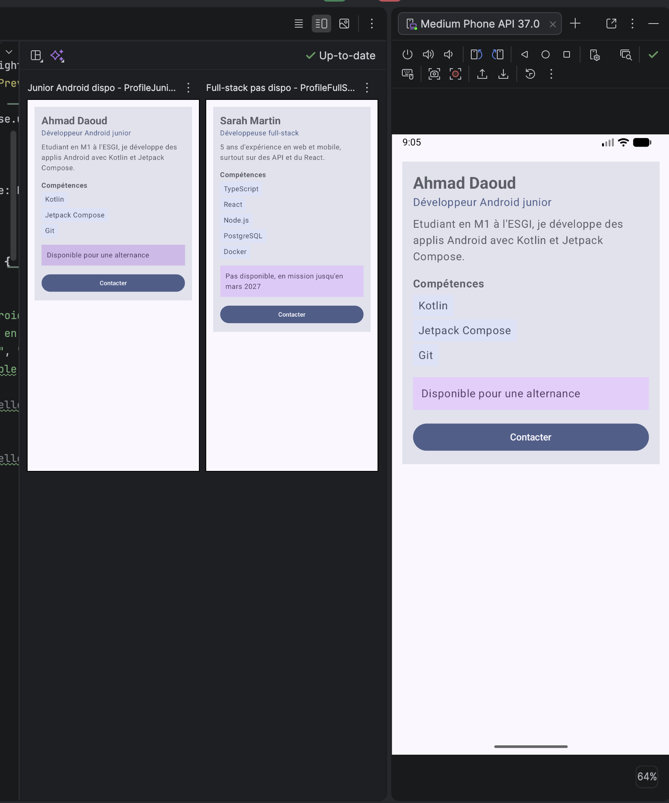

# Profil Ahmad Daoud, Développeur JetpackCompose
Un projet permettant d'afficher mes compétences en tant que dévéloppeur Compose, et d'offrir un moyen de contact, pour le cours ESGI Jetpack Android Compose

L'appli affiche une fiche profil sur un seul écran : nom, rôle, une courte description, la liste des compétences et la disponibilité.
En bas il y a une zone cliquable pour la dispo et un bouton "Contacter".
Les clics ne font rien pour l'instant, ils remontent juste jusqu'à MainActivity via des callbacks.
Il y a 2 previews avec 2 profils différents (un junior Android dispo et une full-stack pas dispo).

## Notions utilisées
- composables
- paramètres
- modifiers et chaînage de modifiers
- padding externe / interne
- callbacks
- Scaffold et innerPadding
- previews
- accessibilité de base (semantics, Role.Button, contentDescription)

## Quels composables ai-je créé?
- `ProfileScreen` : l'écran
- `ProfileCard` : la fiche
- `ProfileHeader` : nom + rôle
- `SkillItem` : une compétence
- `AvailabilityInfo` : la zone cliquable de dispo
- `ContactButton` : le bouton contacter

## Quel composable représente l'écran principal?
`ProfileScreen`, c'est lui qui a le `Scaffold` et qui place la fiche avec le `innerPadding`.

## Ou sont utiliser les paddings externes et internes
- Externe : dans `ProfileScreen`, la fiche reçoit `Modifier.padding(innerPadding).padding(16.dp)`. C'est l'écran (le parent) qui décide où placer la fiche. Pareil dans `ProfileCard` avec les `padding(top = ...)` passés aux `SkillItem`, à `AvailabilityInfo` et au bouton pour les espacer.
- Interne : dans `ProfileCard`, la `Column` a un `padding(16.dp)` pour pas que le texte colle au bord de la fiche. Pareil dans `SkillItem` et `AvailabilityInfo` autour du texte.

En gros l'externe c'est le parent qui place le composant, l'interne c'est le composant qui espace son propre contenu.

## Quel composant reçoit un callback
`ContactButton` et `AvailabilityInfo` reçoivent un `onClick`. Ils le transmettent juste, ils décident pas de ce qui se passe. Le callback remonte par `ProfileCard` et `ProfileScreen` jusqu'à `MainActivity` où il est vide avec un commentaire.

## Quelle information d'accéssibilité sont ajoutés?
Sur `AvailabilityInfo` (zone cliquable perso) j'ai ajouté avec `semantics` :
- `role = Role.Button` pour que le lecteur d'écran l'annonce comme un bouton
- une `contentDescription` qui dit ce que fait le clic

Pour `ContactButton` j'ai rien ajouté car c'est un `Button`, il est déjà reconnu comme bouton par le lecteur d'écran, contrairement à une simple zone avec `clickable`.

## Pourquoi mes composants sont ils réutilisables?
Ils affichent rien en dur, tout passe par des paramètres (nom, rôle, compétence, texte du bouton, callback...). Et ils prennent tous un `modifier: Modifier = Modifier` donc le parent peut les placer comme il veut. La preuve, les 2 previews utilisent les mêmes composables avec des données différentes.

## Capture d'écran

